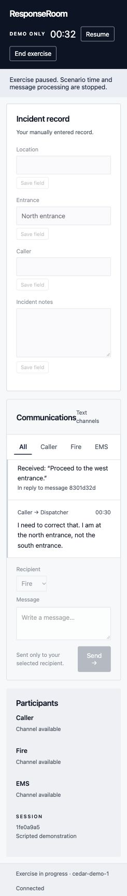
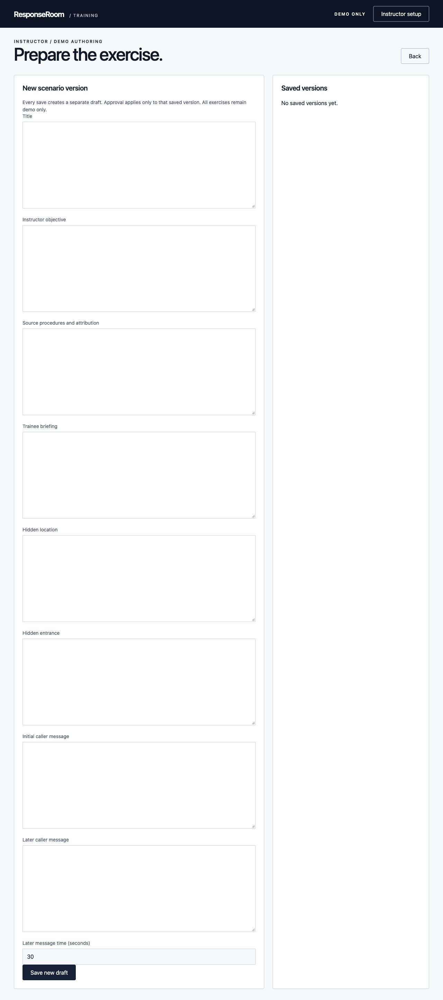

# ResponseRoom

**A fictional, text-based dispatcher training simulator.** One trainee works a simulated call: a scripted caller, Fire and EMS on separate channels, and an incident record they keep by hand. Instructors author and approve every scenario version and write the debrief themselves.

> **DEMO ONLY.** Not approved for operational training. No real procedures, addresses or people are included, and nothing here is emergency guidance.



## Why

In dispatch, *what you wrote down*, *what you transmitted* and *who confirmed it* are three different things, and real mistakes live in the gaps between them. Most training tools blur them by auto-filling records, nudging the next step or scoring live. ResponseRoom keeps them separate and lets the trainee make real mistakes, so the debrief can show exactly what happened.

## What it does

**Trainee (no setup, plain language, large text)**
- Enter your name and start. Every run is a **new situation written by a CREAO agent** (a pool is kept topped up in the background; eight built-in situations are the offline fallback), skipping ones you just had.
- **Live aerial street map:** a fictional district with the incident building and every one of its entrances (or lanes, gates, units, elevators), the Fire station, the ambulance (Medic) base, a hospital and the dispatch center. Fire and the ambulance leave their stations only when you message them and go wherever you last told them; the caller’s marker sits where the caller said they are and moves when they correct it. The map focuses on the street once you save the location in your record.
- **Popups:** nearest centers with distances at the start, then “Engine 4 leaving Station 4 for the east entrance · ETA 01:05”, re-routes and arrivals, all kept in an updates list under the map.
- **Random timing:** every run is different. When the caller’s correction arrives, how many extra caller updates come, how fast units travel and the time limit all vary, so some calls are harder than others. The trainee is not told the level; only the time limit is visible.
- **Outcomes, judged after the call ends:** each unit acts on the last thing it was told. Success means every unit you sent ended up with the corrected detail and your record shows it; failure comes with plain reasons (“Medic 4 went to the eastbound lanes, the wrong place. The last thing they were told was…”). Nothing is judged or hinted during the call.
- **Goals and tasks:** four goals shown up front (quick first dispatch, relay changes fast, accurate record, right place) with per-call results, plus milestones like “three successes in a row”. A progress page shows success rate, goal rates against their aims, what to practice next and what is going well.
- After you have sent something, **Finish call**, **New situation** and **End session** are always one click away.
- Manual incident record (location, entrance, caller, notes). Nothing is prefilled or auto-corrected.
- Separate Caller / Fire / EMS channels. Messages are delivered exactly as said or typed, including wrong content.
- Delivery and acknowledgment are distinct events. Participants read back what they actually received, never facts they weren't sent.
- Recording and transmitting are independent. You can send before recording, record without sending, or both.
- Scripted caller corrections at authored times, optional time limit, pause/resume/end.
- No live hints, suggested replies, missing-step warnings, scores or hidden-truth leaks.
- **Voice, both ways (ElevenLabs).** Every caller, Fire and EMS line is read aloud as it arrives, in a different voice per role; the caller’s voice gets less steady as their distress rises. The trainee talks instead of typing: hold the button (or the space bar), release, and the transcript appears for a quick check before it is sent. Without an ElevenLabs key the device’s own voices read messages and trainees type; a blocked microphone falls back to typing too. Screen-reader announcements; phone-width layout.
- **Fire is yellow, EMS is red:** thin accent lines on the send-to buttons, message bubbles, map markers, stations and the instructor’s timeline. Never used for status or scores.
- **Results take the whole page** when a call ends: outcome, goals and where help ended up, with the previous conversation out of the way. New situation or End session from there.

**Instructor (dashboard first, setup optional)**
- **Runs dashboard:** every trainee run with status, length and automatic observations (was the caller’s correction recorded, and relayed to Fire and EMS?). Filter by trainee. These are keyword checks to guide review, not grades.
- **Difficulty per run (instructor only):** each run draws Easy, Standard or Hard, which sets the correction timing, extra caller updates, unit travel time and time limit. On Hard, units can reach the wrong place before the correction. Levels show per run and per trainee on the dashboard, never to the trainee.
- **Trainee profiles with performance graphs:** outcome of each call, seconds to first dispatch and seconds to relay a change (each against its goal line), goal rates, and focus areas with the evidence behind them (“EMS missed the change in 2 of 3 calls”). Automatic keyword checks, shown as such, never a grade.
- **Run detail:** the map at any replayed moment with the actual location marked, the outcome the trainee saw, a plain-language timeline (no JSON), replay slider, “what really happened vs. the trainee’s record”, an agent map weighted by message volume, and feedback you release when ready. Live runs can be watched or ended.
- Author scenario versions: objective, attributed procedures, briefing, hidden truth, caller lines, readback reply templates, time limit.
- Every save is an immutable draft; only an approved version can launch. Revisions link to their parent.
- **CREAO writes the situations.** A small pool of generated situations is kept topped up automatically (with credit caps), and a single button asks for one more at any time. Each result is checked, built into a complete situation (caller lines, hidden truth, keywords, units, map) and must be unique against the rotation. Any non-built-in situation can be removed with one click.
- **Draft feedback with CREAO.** On a finished run, “Draft with CREAO” sends the run’s evidence (timeline with event numbers, outcome, goals) to a second agent, the Debrief Coach. Its draft is saved as an unreleased “CREAO draft” version; the instructor edits it, confirms it against the timeline and releases it under their own name. Trainees never see an unreleased draft.
- Exercises list; end a running exercise; replay any ended exercise with hidden truth, trainee record and participant knowledge side by side.
- Write feedback as private drafts; release a version only after explicit verification. Review history is append-only.



## Design rules the code enforces

| Rule | How |
|---|---|
| Trainee payload never contains hidden truth, procedures or drafts | Server builds a separate public view; tests check it |
| Participants only know what was delivered | Replies are readback templates that must include `{message}` and are rejected if they mention the hidden truth |
| Exercise log is append-only and replayable | Ordered SQLite event log; timed events stamped at their exact due time |
| Retries never duplicate actions | Per-request IDs; a reused ID with different content is rejected (409) |
| Instructor cannot act as the trainee | The instructor key can end an exercise but not send or record |
| Agent output has no authority | CREAO output that self-approves, cites unsupplied sources or auto-sends dispatcher messages is rejected |

## CREAO integration

ResponseRoom calls the **ResponseRoom Scenario Builder** agent through CREAO's app-scoped API Trigger (`POST /api/v1/apps/{appId}/runs`, then poll the run).
- **Situations:** the server writes the brief itself, listing every situation already in the rotation (place, incident, wrong → right detail) as things to avoid, and asks the Scenario Builder for a new one. A pool of generated situations is topped up in the background (one at a time, with a minimum interval, a daily cap and a pause after repeated refusals). No procedures are sent, so every result stays DEMO ONLY.
- The agent returns a `response-room-scenario/1.0.0` JSON artifact. ResponseRoom validates it, derives the hidden truth from the agent's two-version fact (first report vs. correction), checks that the caller lines actually say those details, and refuses anything that self-approves, cites unsupplied sources or auto-sends dispatcher messages.
- **Uniqueness is enforced:** a result is refused if it shares a title, a place, the same wrong → right pair, or a near-identical caller report with anything in the rotation. The instructor sees the reason and can press again.
- Accepted situations join the rotation immediately, marked “Generated”, with a one-click remove. Rubrics, AI interpretations and participant replies are never imported. Keys never leave the server, and artifact downloads never forward the key to storage redirects.
- **Debrief Coach:** a second agent (`CREAO_DEBRIEF_APP_ID` + `CREAO_DEBRIEF_API_KEY`) receives the finished run’s evidence and returns `{"draft", "citations"}`. The draft is stored as an unreleased review version and only a human can release feedback.
- **Caller agent:** a third agent (`CREAO_CALLER_APP_ID` + `CREAO_CALLER_API_KEY`, set-up in `agents/caller-agent.md`) answers what the trainee says to the caller, in character, with a distress level that also drives the caller’s voice. It is given only the caller’s own lines so far, the recent conversation and the trainee’s message, never the hidden truth or the units. The scripted readback is held for a few seconds; a reply that arrives in time and passes the guard (no coaching, no naming the corrected detail before the caller has said it, no links or stage directions) replaces it, otherwise the readback goes out as before.
- **Transparency:** the welcome page tells trainees where AI is used and lists what the app never does (no hints or warnings during a call, no AI grading, no messages to units the trainee didn’t send, no real procedures). The instructor dashboard shows the same note.

## ElevenLabs voice

Optional, enabled by `ELEVENLABS_API_KEY` in `.env` (`audio.mjs`, `public/audio.js`). The key never reaches the browser.
- **Text to speech:** `GET /api/sessions/:id/audio?event=…` voices a line that is already in that call’s log (never arbitrary text), with the call’s own token or the instructor key. One premade voice per role (`ELEVENLABS_VOICE_CALLER/_FIRE/_EMS` to change them), `eleven_flash_v2_5` by default, caller `voice_settings` driven by a distress level. Identical lines are cached in memory and a daily character budget (`ELEVENLABS_DAILY_CHARS`, default 40 000) protects credits; when it runs out, device voices take over.
- **Speech to text:** the browser records a push-to-talk clip (MediaRecorder, capped at 45 s) and posts it to `POST /api/sessions/:id/speech`; the server forwards it to Scribe (`scribe_v1`) and returns the transcript. Transcripts are never written to the log: only what the trainee sends becomes a message, so the record stays what they actually said. Only the trainee’s token may speak on a call.
- **Fallbacks:** no key → device voices and typed input; blocked microphone → typed input; failed clip → device voice for that line. Tests mock ElevenLabs entirely (`audio.test.mjs`, `voice.test.mjs`).

## Sentry monitoring

Optional, dependency-free reporting to Sentry's envelope endpoint (`sentry.mjs`), enabled by `SENTRY_DSN` in `.env`:
- **Errors:** unexpected server errors (the client only sees a generic 500), uncaught browser errors forwarded through the server (rate-limited), and process crashes.
- **Performance:** one transaction per API call, named by route template (`POST /api/sessions/:id`). The 1-second trainee poll is not traced.
- **AI agent monitoring:** CREAO calls are traced as `ai.agent.run`, `ai.agent.poll` and `ai.validate` spans, tagged with the outcome. Rejected agent output and failed runs are reported as warnings with the validator's reason.
- **Privacy by design:** only operational data is passed in. No message text, record contents, objectives, reviews, request bodies, tokens or keys are sent, and IDs, keys and emails are scrubbed again before sending. Tests parse the envelopes to check this.

## Quick start

Requires **Node.js 24+**. No dependencies to install.

```bash
git clone <this repo> && cd responseroom
npm start
```

Open http://127.0.0.1:4173.

- **Trainee:** click *Start demo*.
- **Instructor:** open http://127.0.0.1:4173/instructor. The instructor key is generated on first run in `.instructor-key` (local file, mode 600, gitignored).
- **CREAO / ElevenLabs / Sentry (optional):** `cp .env.example .env`, set `CREAO_API_KEY` (app-scoped `capi_` key), `ELEVENLABS_API_KEY` and/or `SENTRY_DSN`, restart.

## Tests

```bash
npm test               # 101 tests: engine, HTTP auth, knowledge boundaries, storage isolation, CREAO (scenario, debrief and caller agents), ElevenLabs and Sentry (all mocked), voice
npm run check:secrets  # fails if secrets/local state are tracked or appear anywhere in git history
```

## Security notes

- Binds to `127.0.0.1` only; strict Content-Security-Policy; POST origin check; constant-time key comparison.
- Secrets (`.env`, `.instructor-key`) and the SQLite database are gitignored and never served over HTTP.
- The instructor key is a local capability for a demo, not production identity or access control.

## Project structure

```
server.mjs      HTTP routes, auth, static files
engine.mjs      exercise state, event log, scenarios, reviews, CREAO generations (SQLite)
creao.mjs       CREAO API adapter and output validation
situations.mjs  built-in fictional situations with map params
difficulty.mjs  random difficulty and caller timing per run
generate.mjs    one-button CREAO generation: brief, derivation, uniqueness
audio.mjs       ElevenLabs adapter: per-role voices, caching, budget, transcription
public/audio.js read-aloud queue, device-voice fallback, push-to-talk recorder
observations.mjs outcomes, goals, metrics and instructor observations
public/streetmap.js shared aerial map: geometry, unit movement, popups, rendering
public/insights.js  progress charts, goal rates, focus areas
sentry.mjs      minimal Sentry envelope reporter (errors, transactions, scrubbing)
public/         vanilla JS/CSS client (trainee console + instructor UI)
*.test.mjs      node:test suites
scripts/        pre-publish secret check
docs/screenshots
```

## Limitations

Local single-machine demo; Fire and EMS are scripted readbacks (the caller is conversational only when the CREAO caller agent is connected); one hidden location/entrance per scenario; no production authentication.

## Built with

Node.js 24 (`node:http`, `node:sqlite`, `node:test`), vanilla JavaScript/CSS, CREAO agents, ElevenLabs (text to speech and Scribe transcription), Sentry, browser speech synthesis as the fallback. Development was assisted by AI coding tools.

## License

_Not yet chosen._
